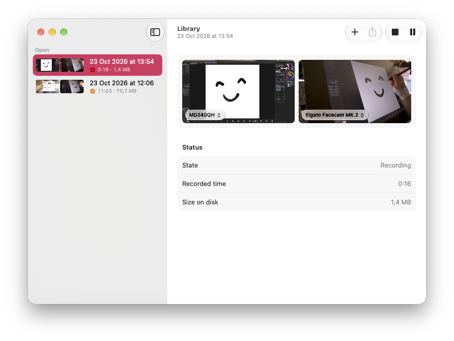

<p align="center">
  
</p>

<h1 align="center">DuoLapse</h1>

<p align="center">
  DuoLapse records timelapses of your screen and webcam in tandem, with minimal memory and CPU footprint.<br>
  Seamlessly pause and resume between multiple recordings; choose the video layout at export.
</p>

<p align="center">
  
</p>

## Features

- **Dual Recording:** Capture screen and webcam separately.
- **Multiple Timelapses:** Seamlessly pause and resume between multiple recordings.
- **Space Saving:** Smart pause skips inactive frames to save disk space.
- **Global Shortcut:** Start or pause instantly with `⌃⌥⌘R`.
- **Menu Bar Controls:** Monitor active recording length and switch sources easily.
- **Always Awake:** Keeps your Mac and webcam active during recording.
- **Crash-Proof:** Timelapses survive crashes and power loss.

**Export Options:**

- **Frame Rate:** 30 fps
- **Length:** 30s, 1m, full, or custom
- **Layouts:** PiP, side-by-side, or vertical stack
- **Screen Fit:** Fill or fit to screen
- **Timestamp:** Optional overlay
- **Codecs:** HEVC or H.264
- **Naming:** Customizable file naming rules

## Install

**Download:**
1. Get `DuoLapse.zip` from the [latest release](https://github.com/domesticatedpigeon/DuoLapse/releases/latest).
2. Unzip it and move `DuoLapse.app` to Applications.

**Homebrew:**

```sh
brew tap domesticatedpigeon/duolapse https://github.com/domesticatedpigeon/DuoLapse
brew install --cask duolapse
```

**First launch:**

DuoLapse isn’t notarised, so macOS blocks it once.

1. Open DuoLapse and click **Done** when macOS can’t verify it.
2. In **System Settings › Privacy & Security**, click **Open Anyway** next to DuoLapse.
3. Enter your password and click **Open Anyway** again.

If macOS says the app is damaged, run this in Terminal, then open it again:

```sh
xattr -dr com.apple.quarantine /Applications/DuoLapse.app
```

## Build

Requires Xcode 26.

```sh
brew install xcodegen
git clone https://github.com/domesticatedpigeon/DuoLapse.git
cd DuoLapse
xcodegen generate
open DuoLapse.xcodeproj
```

- Run `xcodegen generate` again after pulling changes to `project.yml` or new files.
- To keep permissions across rebuilds, install with `scripts/install-local.sh`. See [`RELEASING.md`](RELEASING.md).
- Core tests: `swift test --package-path DuoLapseCore`.

Built with Swift 6, SwiftUI, ScreenCaptureKit and AVFoundation. See [`CLAUDE.md`](CLAUDE.md) for conventions and [`PLAN.md`](PLAN.md) for the roadmap.

## License

[GPL-3.0](LICENSE)
